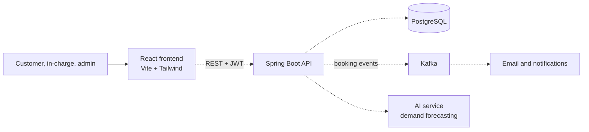
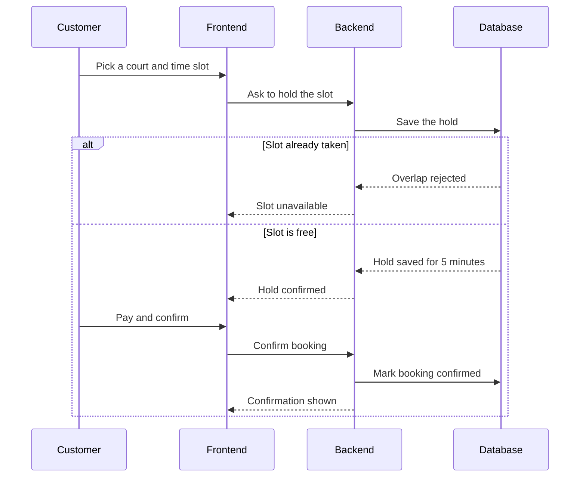

# Bounce 002

A pickleball court booking website for one club with four courts. Players reserve a time slot, court in-charges run their own court, and an admin manages everything.

> **Status:** the React frontend is built and runs on mock data. The Java backend, database and AI features are planned next.

## Who uses it

| Role | What they do |
| --- | --- |
| Customer | Browses the courts, books and cancels time slots |
| Court in-charge | Sees today's bookings for their court and checks players in |
| Admin | Sees all four courts and invites the in-charges |

## Architecture

Solid lines are built. Dotted lines are planned.



## Booking flow

How a booking will work once the backend exists. The frontend already follows the same steps with mock data.



## Tech stack

| Tool | Why we chose it | Status |
| --- | --- | --- |
| React + Vite | Fast to build and reload, and the most common frontend stack | Done |
| Tailwind CSS | Consistent styling without writing separate CSS files | Done |
| React Router | Separate pages and role-protected routes | Done |
| Java + Spring Boot | Industry standard for business backends, with strong security tools | Next |
| PostgreSQL | Reliable database that can block overlapping bookings itself | Next |
| Docker | Runs the database and app the same way on every machine | Next |
| Kafka | Sends booking events to email and notifications without slowing the booking | Planned |
| AI service | Predicts busy hours to suggest prices and flag likely no-shows | Planned |
| Kubernetes | Runs the containers in production | Planned |

## Run it locally

```bash
npm install
npm run dev
```

Open the link it prints (usually http://localhost:5173). On the login page, any valid email and password signs you in as the role you pick.

## Project structure

```
src/
  components/   Navbar, Footer, court drawing, slot grid, dashboard shell
  context/      Demo login state and route protection
  data/         Mock courts and bookings
  pages/        Home, Login, Signup, Customer, Incharge, Admin, NotFound
```

## Roadmap

- [x] Public homepage, login and signup
- [x] Customer, in-charge and admin dashboards on mock data
- [ ] Spring Boot backend with real login and roles
- [ ] PostgreSQL tables and double-booking protection
- [ ] Email verification and payments
- [ ] AI demand forecasting
- [ ] Docker setup and deployment
