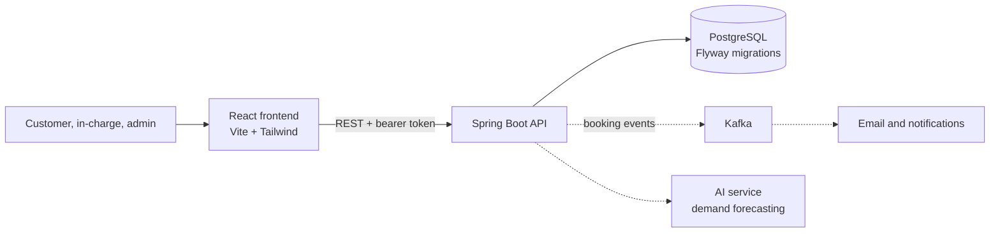
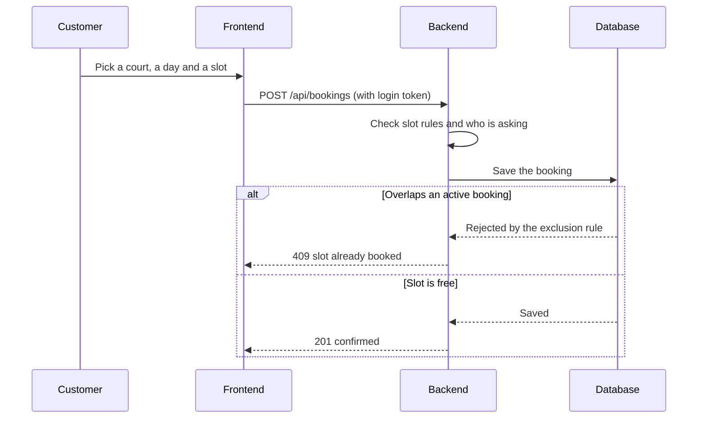

# Bounce 002

A pickleball court booking website for one club. Players book one-hour slots, each court has an in-charge, and an admin manages the courts and staff.

> **Status:** working locally end to end (React frontend, Spring Boot backend, PostgreSQL). Email sending, payments, analytics and deployment are still to come.

## Who uses it

| Role | What they do |
| --- | --- |
| Customer | Signs up, verifies their email, books and cancels slots, sees prices |
| Court in-charge | Invited by the admin. Sees today's bookings for their court and checks players in |
| Admin | Adds and edits courts (name, surface, indoor or outdoor, price, open or closed) and invites in-charges |

## How it is built

Solid lines exist today. Dotted lines are planned.



## How a booking works



Slot holds and payment before confirming are planned.

## Rules the system enforces

- **No double booking.** PostgreSQL itself rejects overlapping bookings on the same court, even if two people click at the same moment.
- **Slots** are one hour, start on the hour, between 8 am and 10 pm club time, and must be in the future.
- **Cancelling** is allowed until 2 hours before the start. Staff can cancel at any time.
- **Accounts:** passwords are hashed with BCrypt, emails must be verified before login, disposable email domains are refused, and 5 wrong passwords block an email for 15 minutes.
- **Sessions, verification, reset and invite links** use random tokens. Only a hash is stored in the database.
- **Roles are checked on the server,** not just hidden in the interface.

## Tech stack

| Tool | Why | Status |
| --- | --- | --- |
| React + Vite | Fast to build, the most common frontend stack | Done |
| Tailwind CSS | Consistent styling without separate CSS files | Done |
| React Router | Pages and role-protected routes | Done |
| Java 25 + Spring Boot 4.1 | Industry standard for business backends | Done |
| Spring Security | Password hashing, token login, role rules | Done |
| PostgreSQL | Reliable, and enforces the no-overlap rule itself | Done |
| Flyway | Versioned database changes | Done |
| JUnit | Unit tests for slot and sign-in rules | Started |
| Docker | Same setup on every machine | Compose file for the database only |
| Kafka | Sends booking events to notifications without slowing bookings | Planned |
| AI service | Predicts busy hours to suggest prices and flag likely no-shows | Planned |
| Kubernetes | Runs the containers in production | Planned |

## Run it locally

You need JDK 25, Node.js, and PostgreSQL.

1. **Database (once).** In pgAdmin or psql, as the admin user:

   ```sql
   CREATE USER bounce WITH PASSWORD 'bounce_dev_password';
   CREATE DATABASE bounce002 OWNER bounce;
   ```

   These are development defaults only. Change them for anything real.

2. **Admin account.** In `backend`, copy `local.properties.example` to `local.properties` (git ignores it) and set your own admin email and password.

3. **Backend:**

   ```bash
   cd backend
   .\mvnw spring-boot:run
   ```

4. **Frontend**, from the project root:

   ```bash
   npm install
   npm run dev
   ```

Open http://localhost:5173. Verification, reset and invite links are printed in the backend log, because real email sending is not connected yet.

## Project structure

```
src/                 React frontend (pages, components, context, api.js)
backend/             Spring Boot backend
  src/main/java/...  auth, booking and court packages
  src/main/resources/db/migration   Flyway scripts V1 to V6
docker-compose.yml   PostgreSQL for Docker users
```

## Roadmap

- [x] Public homepage, login and signup
- [x] Real accounts, roles, email verification and password reset
- [x] Bookings in PostgreSQL with double-booking protection and a cancellation rule
- [x] Courts managed by the admin and shown live on the site
- [ ] Prices in the slot grid, booking summary and history
- [ ] Block a court for maintenance, richer in-charge day view
- [ ] Admin dashboard with real numbers
- [ ] Real emails and clean-up of unverified accounts
- [ ] AI busy-hours forecasting and price suggestions
- [ ] Docker images, free hosting, Kafka and Kubernetes as stretch goals
